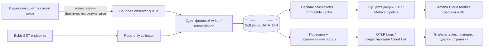

# Этап 4 — Trading Performance: архитектура и план

Архитектура утверждена; реализация и эксплуатационные gates описаны в
[monitoring-stage4.md](monitoring-stage4.md), точность — в
[performance-data-contract.md](performance-data-contract.md). Ниже сохранён
исходный аудит 30.10.2026; его статус «без реализации» относится к дате аудита.

Статус: **исследование и предложение, без реализации**. Проверка 30.10.2026.
Торговый код, существующие настройки, state, SQLite и Grafana resources не менялись.
Deploy, restart, Terraform apply, реальные ордера и вызовы Bybit API не выполнялись.
API изучены по официальной документации; финансовая сверка реального счёта ещё
не проведена. Прибыль, win rate и качество стратегии по этому исследованию не
вычислялись. Незакоммиченные материалы этапа 3 сохранены.

## 1. Что подтверждено в существующем проекте

Локальная база анализа — commit `f928be3eb3c68de93e696eda1aaad3389a6e00a8`.
Read-only проверка Render подтвердила совпадение runtime commit. Через Web Shell
прочитаны только структура и полнота state: без денежных сумм, символов, order IDs
и secrets. Локального `data/state.json` в checkout нет, поэтому его отсутствие
не выдаётся за отсутствие состояния в production. Подробная сводка live-проверки
сохранена отдельно от репозитория; private state не копировался в Git.

| Источник | Уже реализовано | Чего недостаточно для Performance |
|---|---|---|
| `bot.py:101`, `ShortBot.refresh_balance()` | Существующий UNIFIED/USDT balance call; wallet, equity, UPL, available в памяти | Нет истории snapshots; equity/UPL не сохраняются в state |
| `live/accounting.py:23`, `AccountBalance.from_response()` | USDT выбирается по coin; wallet корректируется на spotBorrow; USD available конвертируется и ограничивается для sizing | Это объект для торговли, не полный ledger; Decimal преобразуется в float. Его available — не универсальная биржевая величина |
| `bot.py:308`, `ShortBot.open_position()` | Принятый entry order ID/pending, подтверждение fills через positions, qty/entry, запланированные TP/SL | Legacy-записи не имеют entry ID; нет постоянного positionIdx, actual side/mark/UPL и актуальных биржевых TP/SL |
| `bot.py:465`, `ShortBot.check_positions()` | Проверка tracked symbols, ожидание полной истории закрытия, atomic close/accounting | Не обнаруживает все untracked/manual позиции; не ведёт полный execution/funding/cash-flow ledger |
| `live/accounting.py:67`, `ClosedTrade.from_records()` | Дедуп closing order IDs, сумма partial closes, проверки qty/entry, net closedPnl из Bybit | Entry/exit/qty вычисляются временно, но не входят в risk history; closing time берётся из updatedTime записи, не независимо из fills |
| `live/position_tracker.py:36,55`, `save()/close_position()` | Atomic state replacement, positions/watchlist/cooldowns/risk_state | Закрытая позиция удаляется; полные детали сделки не архивируются |
| `live/risk_manager.py:127`, `on_trade_result()` | time/symbol/pnl_usdt/pnl_percent/order_ids, сортировка результатов, сохранение после restart | История обрезается до 1000; нет entry/exit/fees/funding/reason. Это не полная история счёта |
| `RiskManager.sync_capital()` | current/peak capital синхронизируются с wallet | Wallet peak не является peak equity и не даёт корректный equity drawdown |
| `bot.py:173,206,237`, candidate/watchlist/stall | Текущие local_high/stall/blocked/timestamps, вычисление pump/near-high и списка ready | Pump/candidates/ready и многие skip reasons не сохраняются; сообщения логов не являются журналом решений |
| `monitoring/runtime.py`, `monitoring/metrics.py` | 14 технических Prometheus-имён и bounded API-наблюдения | В API mailbox только operation/result/category/duration; денег, order IDs, fills и решений стратегии там нет |

В live-state найдены legacy-позиции без entry ID. `trades_history` содержит только
краткие записи указанной схемы; комиссии и причины закрытия в ней отсутствуют.
Отсутствие повторяющихся IDs в этой ограниченной истории не доказывает полноту
учёта всего счёта. Файлов SQLite в корне DATA_DIR при проверке не обнаружено.

Нынешнее `pnl_percent` — net P&L относительно entry notional, не доходность на
margin/deposit и не показатель с учётом вводов/выводов. Использовать его как ROI
счёта нельзя. Исследование не меняет эту существующую риск-логику.
`open_time/opened_at_ms` ставятся перед отправкой entry request: точное время
исполнения нужно брать из execution history. Pump в текущем коде считается как
`(last - low24) / low24`, а не как стандартный процент изменения за 24h.

## 2. Принцип учёта

**Bybit — финансовый первоисточник. SQLite — локальный сверенный журнал.
Grafana — представление и мониторинг, не бухгалтерская база.**

Разделить:

- результат всего subaccount и результат подтверждённо принадлежащих боту сделок;
- биржевые факты, локальные торговые намерения и собственные расчёты;
- подтверждённые деньги, неподтверждённую атрибуцию, неизвестную причину закрытия;
- event time биржи, время получения данных и время публикации в Cloud.

Отсутствующий ID не восстанавливать догадкой по ближайшей цене/времени. Для legacy
использовать однозначное доказательство из доступной истории; иначе attribution
`unknown`. Не добавлять orderLinkId и не менять подтверждение/исполнение ордеров
ради мониторинга. Не утверждать, что отдельный субаккаунт всегда использовался
исключительно ботом: это требует подтверждения и сверки.

## 3. Какие read-only источники Bybit нужны

| API | Данные | Использование |
|---|---|---|
| `GET /v5/account/wallet-balance` | coin walletBalance/equity/unrealisedPnl/cumRealisedPnl/spotBorrow; account totalEquity/totalWalletBalance/totalPerpUPL | Точные биржевые snapshots на момент ответа; сохранять исходные строки и валюту |
| `GET /v5/position/list` | side/positionIdx/size/avgPrice/markPrice/unrealisedPnl/curRealisedPnl/takeProfit/stopLoss/seq | Все текущие позиции с pagination, не только tracked symbols |
| `GET /v5/market/tickers` | lastPrice/markPrice, рыночные поля | Last отдельно от Mark, с собственным временем наблюдения; использовать уже полученные данные, где возможно |
| `GET /v5/execution/list` | execId/orderId/execQty/execPrice/execFee/feeCurrency/closedSize/execTime | Частичные fills, реальный объём и стоимость, дедупликация |
| `GET /v5/order/history`, при необходимости `/v5/order/realtime` | status, cumulative fills, positionIdx, stopOrderType/createType/rejectReason, TP/SL metadata | История orders, классификация закрытий и подтверждение неоднозначных результатов |
| `GET /v5/position/closed-pnl` | closedSize, average prices, closedPnl, openFee/closeFee, fillCount, updatedTime | Сверка закрытых результатов, включая изменившиеся/частичные записи |
| `GET /v5/account/transaction-log` | id, cashFlow, funding, fee, change, transfers, cashBalance | Финансирование, комиссии, движения денег и согласование с балансом |

Все эти endpoints — GET; новый collector имеет allowlist только чтения и
отдельную HTTP session. Его класс не содержит place/cancel/amend/transfer methods.
По возможности использовать отдельный read-only Bybit key того же subaccount.
Создание ключа — отдельное ручное действие, secret не попадает в DB/Git/logs.

Исторические endpoints требуют временных окон и pagination, часто максимум 7
дней на запрос. Документация описывает историю до двух лет для ряда источников,
но это не гарантия восстановления всех типов записей. У order history retention
зависит от статуса: fully cancelled/rejected/deactivated доступны в коротком окне
24h, более старая история ограничена orders с fills. Старые ошибки и skip reasons
полностью восстановить нельзя. Фактическое покрытие хранить по endpoint и периоду.

Bybit предупреждает о задержках history. Один order может иметь несколько fills;
одинаковые timestamps не являются уникальными. Пустой/ошибочный ответ и неполная
pagination не являются подтверждением отсутствия позиции или сделки.

## 4. Архитектура без новых серверов



Всё слева до Cloud выполняется внутри того же worker в фоне. Не запускать второй
bot.py, отдельный web service, Collector, Prometheus, PostgreSQL или daemon.

### Почему не прямой SQLite datasource

SQLite plugin требует, чтобы файл был доступен файловой системе сервера Grafana.
Диск Render и сервер Grafana Cloud — разные системы. Worker не имеет публичного
HTTP endpoint для такого чтения. Наличие Infinity plugin тоже не создаёт API к
SQLite. Публиковать DB наружу или встраивать торговые API keys в dashboard нельзя.

Рекомендация — **SQLite + Metrics + управляемый Loki того же Grafana stack**.
Наличие datasource `grafanacloud-tanwolf1218-logs` типа Loki проверено read-only.
Его write permissions, фактический retention и quota не проверялись и не менялись.
Для отправки потребуется Cloud Access Policy scope `logs:write`; имеющегося
`metrics:write` недостаточно. Это не Terraform Service Account token.

### Что куда отправлять

| Хранилище/канал | Данные | Ограничение |
|---|---|---|
| SQLite | Исходные финансовые строки, executions/orders, cash flows, сверка, revisions, snapshots и decision events | Основной локальный архив в рамках disk budget |
| OTLP Metrics | Account snapshots, сверенные агрегаты, freshness/coverage и operational counts | Double/округление и периодический экспорт; не точный реестр копеек/ID |
| Loki JSON rows | Только нужные поля текущих позиций, подтверждённых сделок и strategy state | Проекция, retention/query limits, at-least-once доставка |
| CSV/backup из SQLite | Полная сохранённая история с Decimal strings | Отдельный ручной экспорт; не SQL-запрос из Grafana Cloud |

Labels метрик ограничить account alias, scope, currency, strategy и конечным
набором window/reason/outcome. Order/exec/trade IDs, timestamps, snapshot IDs и
текст ошибок не использовать как labels. В Loki эти поля разрешены в JSON body,
но не в индексируемых labels. Не отправлять headers, ключи, адреса кошельков или
полные HTTP request/response dumps.

### Таблицы и ограничение истории в Cloud

Позиции/стратегия: отдавать согласованную generation текущего view, отмечая
удаления/tombstones. Полный snapshot признаётся только после всех страниц Bybit;
при API error не генерировать массовые закрытия или пустую таблицу «позиций нет».
Повтор публикации не должен создавать вторую строку того же entity/revision.

Сделки: повторно публикуемая каноническая проекция ограниченного размера
(предложение: последние 1000 подтверждённых записей), с revision, closed_at,
published_at и качеством данных. В UI явно показывать лимит, число доступных
записей, полноту и период. Републикация нужна для текущей проекции, но не делает
старую сделку новой: business timestamps остаются исходными.

Нужен **обязательный PoC** штатных LogQL/Grafana transforms на синтетических данных:
JSON extraction, latest revision, complete generation, tombstone, row limits,
сортировка времени и фильтрация по closed_at, отличному от published_at. Нельзя
считать raw Loki log lines или `count_over_time` количеством сделок. Отсутствующий
кусок snapshot/ограничение результата должны давать «неполные данные», а не ноль.
Фильтр времени ingestion нельзя выдавать за фильтр времени закрытия.
Возможный контракт PoC: entity rows и завершающий manifest с generation и
expected row count; последняя подтверждённая generation выбирается отдельно,
проверяются unique entity keys и полнота. Generation — поле payload/числовое
значение метрики, не растущий Prometheus/Loki index label. Это проектный вариант,
не утверждение, что требуемое связывание уже проверено в Grafana.

**Произвольный SQL по всей SQLite из Grafana Cloud эта схема не даёт.** Cloud Logs
имеет retention; документация Free описывает 14-дневный минимум, но настройки
этого stack надо проверить отдельно. Обещать бесконечную полную историю в Grafana
нельзя. Старые подробности остаются в SQLite/экспорте; сводки считаются по всему
подтверждённому покрытию SQLite. Если обязательна любая историческая SQL-выборка
непосредственно в Grafana без лимитов представления, придётся изменить одно из
ограничений архитектуры. До такого решения не подменять её approximate таблицей.

## 5. Предлагаемая модель SQLite

Новый файл `DATA_DIR/performance.sqlite3`; существующий state.json остаётся как есть.
Денежные значения/qty/price — исходные decimal strings и Python Decimal;
SQLite REAL и существующие float risk_state не являются финансовым первоисточником.
Все времена — UTC epoch milliseconds, отображение Grafana — Europe/Tallinn/browser.

| Таблица | Содержание / ключ |
|---|---|
| schema_migrations, accounts | Версия схемы, безопасный alias и область счёта/валют |
| account_snapshots | exchange time + received time, raw coin/account fields, freshness |
| positions_current | account/category/symbol/positionIdx, side, qty, entry, Mark/Last, actual TP/SL, UPL |
| orders, order_revisions | account/category/orderId, status, cumulative fields, обновления |
| executions | account/category/execId, symbol/orderId, exact fills, fee/currency, execution time |
| closed_pnl, closed_pnl_revisions | account/category/symbol/orderId, исходный результат и его revision |
| cash_transactions | account + Bybit transaction id, type/currency, cashFlow/funding/fee/change |
| position_cycles, cycle_executions | Периоды flat→position→flat по account/category/symbol/positionIdx, связь fills |
| strategy_events, strategy_current | Наблюдённые decisions, watchlist/pump/stall, outcome/reason, snapshot coverage |
| sync_windows, reconciliation_runs | Endpoint coverage, gaps, watermark и результат сверки |
| export_outbox | Entity/revision/destination, bounded retries, подтверждение доставки |

Не удалять/исправлять financial факт без revision. Разделить `money_status`,
`attribution_status`, `reason_status`: точный P&L с неизвестной причиной закрытия
возможен, но неизвестная принадлежность не должна попасть в KPI стратегии бота.

### Повторы, partial fills и crash recovery

1. UPSERT executions по execId, orders по orderId, transactions по id с account
   scope. Один order не равен одному execution и не обязательно целой позиции.
2. Изменившаяся Closed PnL запись с тем же orderId заменяет каноническую revision,
   а не прибавляется ещё раз. Сохранять source updatedTime и fingerprint.
3. Сверка/window checkpoint и исходные записи фиксируются транзакционно. Отмечать
   окно complete только после всех страниц; cursor не заменяет durable watermark.
4. После restart перечитывать перекрывающиеся интервалы, затем проходить gaps.
   Повтор API page или outbox send не создаёт новый финансовый результат.
5. Учитывать IOC partial fill/cancel, изменения размера, partial closes, hedge mode,
   reversal, ручные сделки и liquidation/settlement отдельно. Если данные не дают
   однозначно восстановить цикл — `pending/unknown`, не nearest-time matching.
6. Callback при торговле только кладёт bounded event. Его потеря не блокирует
   ордер; финансовые факты восстанавливаются через GET reconciliation. Потерянные
   skip reasons восстановить нельзя — фиксировать gap, не имитировать решения.

Общей атомарной транзакции между state.json и SQLite нет. Не добавлять ожидание
SQLite commit на пути торгового order ради её имитации: финансовую полноту после
разрыва обеспечивает последующая сверка Bybit, с явным pending до её завершения.

## 6. Определения показателей

**Balance/equity/UPL.** Показывать биржевые поля на время snapshot. Отдельно
USDT coin equity и total account equity USD; не складывать их как одну валюту.
Wallet raw, wallet net of spotBorrow и trading-available имеют разные подписи.
UPL позиции брать из Bybit по Mark, Last показывать отдельно. Это не прогноз
net-выхода после будущей closing fee. Snapshots разных endpoints не атомарны;
время и stale status обязательны.
Полная pagination тоже не делает несколько ответов единым атомарным биржевым
snapshot: сохранять окно получения/время каждой позиции и обнаруживать изменения
между страницами. Не выдавать такой набор за состояние всех позиций в одну наносекунду.

**Realized и closed P&L.** Различать cumulative realised биржи, realized за
выбранный период и результат полностью закрытого цикла. Открытая позиция уже
может иметь realized components из partial closes/fees/funding.
У Bybit net closedPnl уже учитывает trading и funding fees: повторно вычитать
openFee/closeFee/funding нельзя. Исполнения и transaction log дают детализацию
и проверку, а не второй слой списания поверх того же net результата.

**Денежная сверка.** У transaction log `change = cashFlow + funding - fee`;
funding >0 — получение, fee >0 — расход, fee <0 — rebate. Сохранять знак и валюту.
Сопоставлять cash changes и balance на согласованных границах. Вводы/выводы,
переводы, бонусы, заимствования и иные не-торговые движения учитывать отдельно;
не отфильтровывать их преждевременно только category=linear. Fees в другой валюте
не складывать с USDT без подтверждённого способа конвертации. При несовпадении
времён/неполной истории — pending, а не искусственная balancing entry.

**Накопленная прибыль.** Два отдельных графика: net closed-trade result сверенных
циклов и результат счёта с поправкой на подтверждённые не-торговые денежные потоки.
Пополнение кошелька не является прибылью. Полная equity curve начинается с реально
собранных snapshots; прошедшую UPL/equity из закрытых сделок восстановить точно нельзя.
Cash-flow-adjusted кривая допустима только при полном покрытии нужных cash flows;
точный TWR/ROI без оценок equity в нужные моменты не обещается.

**Win rate / averages / PF.** Единица статистики — подтверждённый полностью закрытый
flat-to-flat цикл, не API request, fill или строка closed-pnl. N включает wins,
losses и breakeven; win rate = wins/N. Средняя прибыль — сумма положительных net
результатов / wins, средний убыток — сумма отрицательных / losses. Profit factor =
gross profits / abs(gross losses). N=0 — No data; нет losses — отдельное состояние
`no_losses`, не выдуманное конечное число. Если доступна только статистика closing
orders, обозначать её именно так и не смешивать с позиционными циклами.

**Maximum drawdown.** Считать по equity snapshots и явно указывать окно, частоту,
валюту и влияние cash flows. Это максимум среди наблюдений, нижняя оценка истинной
непрерывной просадки; минутный ряд не обнаружит любой внутриминутный минимум.
`risk_state.peak_capital` не использовать как peak equity.

**Close reason / counts.** TP/SL/manual/liquidation/ADL/mixed/unknown классифицировать
по order/execution metadata и подтверждённым связям, не по близости цены к local TP.
Unknown не маскировать под TP/SL. Считать отдельно entry orders с fills, closing
orders, partial exits и полные закрытия циклов; один fill не увеличивает все эти
счётчики. API place_order error/timeout не равен подтверждённому rejected order:
неоднозначный исход сначала сверяется с биржей.

Все сводки показывают scope, coverage start/end, время последней сверки и число
pending/unattributed записей. Метрики через OTLP — представление с double precision;
точные Decimal amounts остаются в SQLite/экспорте. P&L и исправляемые агрегаты —
gauges, а не монотонные Prometheus counters. Не вычислять выбранный исторический
win rate через rate(increase) технических counters после restart.

## 7. Рабочие циклы и безопасность

Начальные предлагаемые интервалы: account/positions 60s, deltas history 1–5m,
strategy snapshot по уже существующей обработке свечи. Сначала переиспользовать
существующие ответы. Дополнительный GET collector — отдельный выключенный флаг
до согласования; backfill — low priority и с ограничением количества страниц.
API quotas/IP, CPU и disk общие с торговлей: фоновый поток не гарантирует нулевого
влияния. Нужны самостоятельный rate budget, backoff только GET, timeouts и pause
backfill при нагрузке; текущие торговые retries не менять.

Не вызывать повторно `check_stall()` или `can_trade_today()` ради dashboard:
они имеют побочные эффекты. Наблюдать фактически использованные значения,
scheduled bar и timestamp реальной input candle. Не пересчитывать историческое
решение по текущим котировкам. При restart повторная обработка той же свечи —
отдельное реальное наблюдение с run/sequence ID; execution не дублируется в ledger
благодаря exchange IDs. Саму торговую обработку свечей здесь не исправлять.

Предлагаемые флаги: `PERFORMANCE_ENABLED=false`,
`PERFORMANCE_READONLY_API_ENABLED=false`, `PERFORMANCE_LOG_EXPORT_ENABLED=false`.
Ошибки SQLite/export/observer не меняют args/results/exceptions торговых методов,
не вызывают повтор order, не пропускают обработку позиции и не пишут в state.
Никакой обратной связи из аналитического ledger в RiskManager/strategy.

## 8. Как уложиться в persistent disk 1 GB

WAL, один writer, короткие transactions/readers; FULL durability для финансовых
записей, контролируемые checkpoints. Базу не открывать из торгового потока.
Фактическую sqlite3 version, режимы и backup проверить до внедрения на fixtures.

Предлагаемый стартовый бюджет, требующий измерения реальных row/index sizes:

| Компонент | Планируемая граница |
|---|---|
| performance.sqlite3 | soft cap 200 MiB, включая raw/outbox |
| WAL | контролируемая целевая граница около 32 MiB, не обещание жёсткого лимита |
| Один SQLite backup | до 200 MiB; создавать только при достаточном free space |
| Собственные performance logs | до 10 MiB с ротацией |
| Свободный запас | не менее 200 MiB перед тяжёлой работой/backfill |

Current positions — UPSERT, не бесконечная копия каждой позиции каждую минуту.
Account snapshots — 1m за 30–60 дней, затем оговорённые rollups; resolution виден
в графиках. Decision detail — только значимые candidate/watchlist/entry outcomes,
ограниченный срок; причины остальных отсеиваний агрегируются по finite enum.
Raw повторяющиеся полные API payloads не сохранять постоянно. Предложенные caps
не являются подтверждением вместимости всей будущей истории.

Например, 20 позиций × 1440 snapshots/day × условный 1 KiB — уже около 28 MiB/day
до indexes/WAL. Это инженерная оценка, не измерение текущей нагрузки. Поэтому
поминутный position archive без retention не подходит для 1 GB.

Финансовые факты не удалять молча ради лимита. При приближении к cap сначала
пауза backfill/вторичных snapshots, degraded status и согласованный архивный
экспорт. Не обещать бесконечный финансовый архив на 1 GB. Существующий bot.log
и state backups входят в общий budget; их автоматическое удаление не предлагается.
Backup делать SQLite backup API, не копированием одного .db при активном WAL.
Копия на том же disk не защищает от потери всего disk; внешний архив на компьютер
владельца — отдельный согласованный экспорт, без нового сервера.

## 9. Предлагаемый Trading Performance Dashboard

1. Data quality banner: scope, attribution/coverage, as-of, pending/gaps.
2. Wallet/equity/UPL, realized за период, net closed result, fees/funding раздельно.
3. Equity curve, cumulative closed profit, cash-flow-adjusted result при наличии
   покрытия, observed drawdown; подписи currency/period/resolution.
4. Open positions table: symbol/positionIdx/side, actual entry, Mark/Last с as-of,
   qty и notional, actual TP/SL отдельно от local planned, exchange UPL, status.
5. Closed trades table: times, entry/exit VWAP, qty, fees/currencies, funding,
   verified net, reason/unknown, attribution/reconciliation, partial-close details.
6. Win rate, avg win/loss, profit factor, N/breakeven и observed max drawdown.
7. Strategy table: actual pump/stall/local high/blocked/ready, фактический
   skip reason и время решения; не симуляция нового решения.
8. Entry orders / exit orders / partial exits / completed cycles / TP / SL /
   unknown close reason / SDK order errors / exchange rejections — разные counts.

Набор bounded KPI windows для первой версии: all-covered, UTC day, rolling 7d/30d.
Нельзя обещать, что смена time picker автоматически пересчитает любой SQL KPI:
семантика окон должна быть реализована и подписана. Произвольный drilldown периода
через Loki — отдельная проверка PoC, не готовая возможность.
Reason codes брать только из реально существующих веток: cooldown, already tracked,
TTL, below planned TP, position limit, balance unavailable, risk refusal,
exchange position exists, insufficient funds, minimum order exceeds available,
market/API data missing, order outcome pending. Не объявлять проверенным guard,
который только присутствует в config, но фактически не выполняется.

## 10. Порядок реализации после утверждения

| Шаг | Результат | Gate |
|---|---|---|
| 4.0 Data contract + synthetic Cloud presentation PoC | Подтверждены freshness, полная generation, latest revision, tombstones, limits и business time | Без real money и без Render deploy; использование тестового Cloud stream/apply только по разрешению |
| 4.1 SQLite и расчёты офлайн | Migrations, Decimal model, unique constraints, recovery, budgets, fixtures | Никаких live API и импорта bot.py |
| 4.2 Наблюдения существующего цикла | Default-off hooks без изменения decisions/arguments/state | Регрессии disabled/enabled/broken observer и отсутствие повторных вызовов |
| 4.3 Read-only collector/reconciliation | Разрешённые GET, окна/cursors/gaps, attribution, cash-flow checks | Отдельный rate budget и фиксация реального coverage; permission/ключи согласуются отдельно |
| 4.4 Метрики/табличные проекции + dashboard JSON/Terraform | UI читает сверенные данные и честно отображает pending/No data | План ресурсов, Cloud quota/privacy, paused alerts; apply только после подтверждения |
| 4.5 Production rollout | Backup state/SQLite, один согласованный deploy и проверка качества данных | Отдельное разрешение на deploy; текущий restart-risk не исчезает |

Быструю полезную первую версию строить с account snapshots/actual positions и
явным качеством данных. Не откладывать их ради неподтверждённых all-time KPI,
но и не называть сырую legacy history точным performance бота.

### Файлы, которые предполагаются в будущем

```text
performance/
  runtime.py, observations.py, bybit_reader.py
  storage.py, migrations/001_initial.sql
  reconciliation.py, calculations.py, projections.py, exporters.py
scripts/performance_readonly_audit.py
scripts/performance_export.py
tests/test_performance_{storage,reconciliation,calculations,observations,exporters}.py
infra/grafana/dashboards/trading-performance.json
infra/grafana/  # расширение catalog/build и отдельного dashboard resource
docs/performance-data-contract.md
```

`bot.py` в будущем получает только наблюдения существующих результатов/решений.
`live/risk_manager.py`, `PositionTracker.save/close_position`, параметры ордеров,
TP/SL, retries, confirmation и Telegram не меняются. Requirements проверяются
только на нужный export transport; sqlite3 входит в Python, ORM не обязателен.
В текущем исследовании эти изменения не выполнены.

### Обязательные тесты

- Decimal суммы/валюты/знаки, fees rebates и funding; отсутствие double subtraction
  из closedPnl; partial fills/partial closes, обновление одного close order.
- Повтор page/event после restart, crash до/после commit/checkpoint/export ack;
  delayed/out-of-order records и пересчёт revisions без двойного P&L.
- IOC partial/cancel, ambiguous timeout, hedge/reversal, untracked/manual позиции,
  legacy без ID, unknown reason, несовпадение объёма/полноты.
- Cash deposit/withdrawal не прибыль; incomplete flow coverage, разные currencies,
  ноль сделок/нет losses, equity sampling и observed drawdown, UTC/DST.
- SQLite lock/full/WAL/backup, bounded queue/outbox и зависший Cloud; неизменные
  торговые args/result/exception/call order, ноль дополнительных write requests.
- PoC projection: отсутствующая страница, duplicate publish, поздняя correction,
  tombstone, genuine empty portfolio, old business time/new ingestion time,
  query row truncation и expired Cloud data — без ложной полноты.
- Terraform validate/mock plan, dashboard JSON/PromQL/LogQL coverage; тесты не
  должны импортировать runtime bot или пользоваться торговыми ключами.

Критерий готовности: каждая панель имеет определённые scope/currency/time/quality;
сверенный результат соответствует Bybit на покрытом интервале, а неподтверждённый
не отображается как точный. Ни один аналитический отказ не меняет торговую операцию.

## Проверенные источники

Код (прикреплён к проверенному commit):

- [Balance и существующие trading hooks](https://github.com/Ilja-Lobossok/bybit-shortBot/blob/f928be3eb3c68de93e696eda1aaad3389a6e00a8/bot.py#L101)
- [AccountBalance / ClosedTrade](https://github.com/Ilja-Lobossok/bybit-shortBot/blob/f928be3eb3c68de93e696eda1aaad3389a6e00a8/live/accounting.py#L23)
- [State persistence](https://github.com/Ilja-Lobossok/bybit-shortBot/blob/f928be3eb3c68de93e696eda1aaad3389a6e00a8/live/position_tracker.py#L36)
- [Risk history](https://github.com/Ilja-Lobossok/bybit-shortBot/blob/f928be3eb3c68de93e696eda1aaad3389a6e00a8/live/risk_manager.py#L127)
- [Существующий BybitClient](https://github.com/Ilja-Lobossok/bybit-shortBot/blob/f928be3eb3c68de93e696eda1aaad3389a6e00a8/live/bybit_client.py#L100)

API и platform (проверка документации 30.10.2026):

- [Wallet balance и валюты](https://bybit-exchange.github.io/docs/v5/account/wallet-balance)
- [Position info](https://bybit-exchange.github.io/docs/v5/position)
- [Executions / partial fills](https://bybit-exchange.github.io/docs/v5/order/execution)
- [Order history и retention статусов](https://bybit-exchange.github.io/docs/v5/order/order-list)
- [Closed PnL](https://bybit-exchange.github.io/docs/v5/position/close-pnl)
- [USDT Closed/Realized P&L и комиссии](https://www.bybit.com/en/help-center/article/Profit-Loss-calculations-USDT-Contract)
- [Transaction log и знаки денежных потоков](https://bybit-exchange.github.io/docs/v5/account/transaction-log)
- [SQLite plugin: требование локального filesystem Grafana](https://grafana.com/grafana/plugins/frser-sqlite-datasource/)
- [Render Worker: без входящего трафика](https://render.com/docs/background-workers)
- [Grafana JSON/table transforms](https://grafana.com/docs/grafana/latest/visualizations/panels-visualizations/query-transform-data/transform-data/)
- [Cloud Logs retention/pricing](https://grafana.com/docs/grafana-cloud/platform/pricing-and-usage/logs/)
- [SQLite WAL](https://www.sqlite.org/wal.html), [online backup](https://www.sqlite.org/backup.html)
